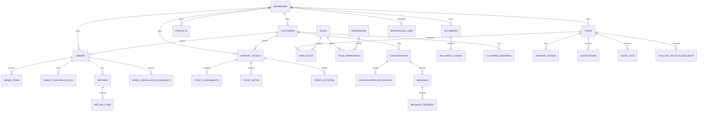

# 04 — Database Design

## 1. Document Information

| Field | Details |
|---|---|
| Project | AI-Powered E-commerce Customer Support Agent |
| Document | Database Design |
| Version | 1.1 |
| Status | Revised Draft — Pending Approval |
| Database | PostgreSQL |
| Vector Extension | pgvector |
| ORM | SQLAlchemy |
| Migration Tool | Alembic |
| Primary Identifier | UUID |
| Initial Business Model | Single business, tenant-aware schema |
| Embedding Dimension | Provisionally 1536 |

---

# 2. Database Design Objectives

The database must support:

1. Customer authentication and authorization.
2. Customer profiles and business information.
3. Products, inventory and orders.
4. Order tracking and cancellation requests.
5. Refund eligibility and approval workflows.
6. Support tickets, assignments, notes and activity history.
7. Customer conversations and AI messages.
8. Knowledge-base document management.
9. Vector and keyword-based retrieval.
10. Customer memory and conversation summaries.
11. Notifications.
12. Audit logging.
13. Background job processing.
14. Refresh-token rotation and revocation.
15. Account-deletion requests.
16. Analytics and reporting.

The schema must be modular, secure, relationally consistent and suitable for future multi-business support.

---

# 3. Database Technology

| Component | Technology | Purpose |
|---|---|---|
| Relational database | PostgreSQL | Persistent application data |
| Vector extension | pgvector | Semantic search |
| ORM | SQLAlchemy | Database interaction |
| Migrations | Alembic | Schema version control |
| Full-text search | PostgreSQL FTS | Keyword retrieval |
| Indexing | B-tree, GIN | Query optimization |
| Vector indexing | Exact search initially | Semantic retrieval |
| Future vector index | HNSW | Optimized approximate nearest-neighbor search |

## 3.1 Why PostgreSQL?

PostgreSQL is selected because the project requires:

- Relational integrity.
- ACID transactions.
- Foreign-key constraints.
- Complex joins.
- JSON support.
- Full-text search.
- Vector similarity search through pgvector.
- Transaction-safe order and refund workflows.

A separate vector database is unnecessary for the initial project.

## 3.2 Database Extensions

Initial extensions:

```sql
CREATE EXTENSION IF NOT EXISTS pgcrypto;
CREATE EXTENSION IF NOT EXISTS vector;
```

`pgcrypto` provides UUID-generation functions where required.

`vector` enables pgvector data types and similarity operations.

---

# 4. Multi-Tenancy Strategy

The application initially supports one demo business.

However, the schema will include `business_id` in business-owned records from the beginning.

This avoids redesigning the database if the project later supports multiple businesses.

## 4.1 Business Isolation Rules

1. Every business-owned record must belong to a business.
2. Every authenticated user must have an associated business.
3. Business context must be derived from authenticated server-side context.
4. The frontend cannot choose an arbitrary business ID to gain access.
5. Database queries must apply business-level filtering.
6. Composite foreign keys should prevent cross-business relationships.
7. Business-level authorization must be tested.

The initial deployment will use one configured demo business. The server will select its business context from configuration rather than trusting a request parameter.

---

# 5. Primary Entities

The database contains the following logical groups.

## 5.1 Identity and Authorization

- businesses
- users
- roles
- permissions
- user_roles
- role_permissions
- refresh_tokens

## 5.2 Customer and Commerce

- customers
- products
- orders
- order_items
- order_tracking_events
- refunds
- refund_items
- refund_policies
- order_cancellation_requests

## 5.3 Support Management

- support_tickets
- ticket_assignments
- ticket_notes
- ticket_activities

## 5.4 AI and Conversations

- conversations
- conversation_participants
- messages
- message_feedback
- customer_memories

## 5.5 Knowledge Base

- documents
- document_chunks

## 5.6 Operations and Governance

- notifications
- audit_logs
- background_jobs
- account_deletion_requests
- idempotency_keys

---

# 6. Entity Relationship Diagram

The following diagram represents the main relationships. It is a logical overview; detailed constraints are defined in subsequent sections.



---

# 7. Detailed Table Design

## 7.1 businesses

Stores business or tenant information.

| Column | Type | Constraint |
|---|---|---|
| id | UUID | Primary key |
| name | VARCHAR(150) | NOT NULL |
| slug | VARCHAR(100) | UNIQUE, NOT NULL |
| is_active | BOOLEAN | DEFAULT TRUE |
| settings | JSONB | DEFAULT '{}' |
| created_at | TIMESTAMPTZ | NOT NULL |
| updated_at | TIMESTAMPTZ | NOT NULL |

Purpose:
- Identifies the business.
- Provides tenant-level data ownership.
- Stores business configuration.

## 7.2 users

Stores application login identities for customers, agents and administrators.

| Column | Type | Constraint |
|---|---|---|
| id | UUID | Primary key |
| business_id | UUID | FK, NOT NULL |
| email | VARCHAR(255) | NOT NULL |
| password_hash | VARCHAR(255) | NOT NULL |
| full_name | VARCHAR(150) | NOT NULL |
| is_active | BOOLEAN | DEFAULT TRUE |
| is_verified | BOOLEAN | DEFAULT FALSE |
| last_login_at | TIMESTAMPTZ | NULL |
| created_at | TIMESTAMPTZ | NOT NULL |
| updated_at | TIMESTAMPTZ | NOT NULL |

Constraints:
- Unique `(business_id, email)`.
- Unique `(business_id, id)` for composite tenant relationships.
- Email normalization must occur before storage.
- Passwords must never be stored in plaintext.

A user may have multiple roles through `user_roles`.

For the initial application, customer and staff accounts will be associated with the appropriate customer profile or staff role.

## 7.3 roles

Defines application roles.

| Column | Type | Constraint |
|---|---|---|
| id | UUID | Primary key |
| name | VARCHAR(50) | UNIQUE, NOT NULL |
| description | TEXT | NULL |
| created_at | TIMESTAMPTZ | NOT NULL |

Initial roles:

- CUSTOMER
- SUPPORT_AGENT
- ADMIN
- BUSINESS_OWNER

## 7.4 permissions

Stores individual permissions.

| Column | Type | Constraint |
|---|---|---|
| id | UUID | Primary key |
| code | VARCHAR(100) | UNIQUE, NOT NULL |
| description | TEXT | NULL |

Example permission codes:

- `customer.read_own`
- `customer.update_own`
- `order.read_own`
- `order.read_assigned_customer`
- `order.manage`
- `refund.read_own`
- `refund.request`
- `refund.approve`
- `ticket.create`
- `ticket.read_own`
- `ticket.read_assigned`
- `ticket.assign`
- `ticket.update`
- `ticket.internal_note`
- `knowledge.read`
- `knowledge.upload`
- `knowledge.replace`
- `knowledge.delete`
- `user.manage`
- `audit.read`
- `analytics.read`
- `settings.manage`

## 7.5 user_roles

Maps users to roles.

| Column | Type | Constraint |
|---|---|---|
| business_id | UUID | FK |
| user_id | UUID | FK |
| role_id | UUID | FK |
| assigned_at | TIMESTAMPTZ | NOT NULL |
| assigned_by | UUID | FK to users, nullable |

Primary key: `(user_id, role_id)`.

The business ID must match the associated user and role assignment.

## 7.6 role_permissions

Maps roles to permissions.

| Column | Type | Constraint |
|---|---|---|
| role_id | UUID | FK |
| permission_id | UUID | FK |

Primary key: `(role_id, permission_id)`.

The MVP will use explicit permission mappings rather than vague permission categories such as "restricted" or "as configured".

### Initial permission matrix

| Capability | Customer | Agent | Admin | Owner |
|---|---|---|---|---|
| View own profile | Yes | Staff profile | Staff profile | Staff profile |
| View own orders | Yes | No by default | Yes | Yes |
| View assigned customer orders | No | Yes | Yes | Yes |
| Create support ticket | Yes | On behalf of customer, if authorized | Yes | Yes |
| View own tickets | Yes | No | Yes | Yes |
| View assigned tickets | No | Yes | Yes | Yes |
| Assign tickets | No | No by default | Yes | Yes |
| Add internal notes | No | Yes, permitted tickets | Yes | Yes |
| Upload KB documents | No | Yes | Yes | Yes |
| Replace/delete KB documents | No | No by default | Yes | Yes |
| Check refund eligibility | Own orders | Authorized workflow | Yes | Yes |
| Approve refunds | No | No | Yes | Yes |
| View audit logs | No | No | Yes | Yes |
| Manage users | No | No | Yes | Yes |
| View analytics | No | Limited operational view | Yes | Yes |

The exact initial permission seed data must be stored in migrations or controlled seed scripts.

Business owners and administrators must not automatically bypass every authorization rule. Refund approval and other sensitive actions must follow explicit policies.

---

# 8. Customer and Commerce Tables

## 8.1 customers

Stores customer-specific information.

| Column | Type | Constraint |
|---|---|---|
| id | UUID | Primary key |
| business_id | UUID | FK |
| user_id | UUID | FK, UNIQUE per business |
| phone | VARCHAR(20) | NULL |
| address | JSONB | NULL |
| preferences | JSONB | DEFAULT '{}' |
| created_at | TIMESTAMPTZ | NOT NULL |
| updated_at | TIMESTAMPTZ | NOT NULL |

A customer profile is linked to a login identity through `user_id`.

## 8.2 products

Stores product information.

| Column | Type | Constraint |
|---|---|---|
| id | UUID | Primary key |
| business_id | UUID | FK |
| sku | VARCHAR(100) | NOT NULL |
| name | VARCHAR(200) | NOT NULL |
| description | TEXT | NULL |
| price | NUMERIC(12,2) | NOT NULL |
| stock_quantity | INTEGER | NOT NULL |
| is_active | BOOLEAN | DEFAULT TRUE |
| created_at | TIMESTAMPTZ | NOT NULL |
| updated_at | TIMESTAMPTZ | NOT NULL |

Constraints:
- Unique `(business_id, sku)`.
- `price >= 0`.
- `stock_quantity >= 0`.

## 8.3 orders

Stores order-level information.

| Column | Type | Constraint |
|---|---|---|
| id | UUID | Primary key |
| business_id | UUID | FK |
| customer_id | UUID | FK |
| order_number | VARCHAR(50) | NOT NULL |
| status | VARCHAR(30) | NOT NULL |
| subtotal | NUMERIC(12,2) | NOT NULL |
| shipping_fee | NUMERIC(12,2) | DEFAULT 0 |
| tax_amount | NUMERIC(12,2) | DEFAULT 0 |
| total_amount | NUMERIC(12,2) | NOT NULL |
| carrier | VARCHAR(100) | NULL |
| tracking_number | VARCHAR(150) | NULL |
| tracking_url | TEXT | NULL |
| placed_at | TIMESTAMPTZ | NOT NULL |
| shipped_at | TIMESTAMPTZ | NULL |
| delivered_at | TIMESTAMPTZ | NULL |
| cancelled_at | TIMESTAMPTZ | NULL |
| created_at | TIMESTAMPTZ | NOT NULL |
| updated_at | TIMESTAMPTZ | NOT NULL |

Constraints:
- Unique `(business_id, order_number)`.
- Composite ownership relationship to customers.
- Monetary values cannot be negative.
- `delivered_at` cannot precede `placed_at`.
- Order status must be an allowed value.

Initial order statuses:

- PENDING
- CONFIRMED
- PROCESSING
- SHIPPED
- DELIVERED
- CANCELLATION_PENDING
- CANCELLED
- FAILED

Order status transitions must be validated by the service layer.

## 8.4 order_items

Stores individual products within an order.

| Column | Type | Constraint |
|---|---|---|
| id | UUID | Primary key |
| business_id | UUID | FK |
| order_id | UUID | FK |
| product_id | UUID | FK |
| quantity | INTEGER | NOT NULL |
| unit_price | NUMERIC(12,2) | NOT NULL |
| line_total | NUMERIC(12,2) | NOT NULL |

Constraints:
- `quantity > 0`.
- Prices cannot be negative.
- Composite foreign keys must enforce business consistency.

The order item preserves the price at purchase time, even if the product's current price changes.

## 8.5 order_tracking_events

Stores tracking history.

| Column | Type | Constraint |
|---|---|---|
| id | UUID | Primary key |
| business_id | UUID | FK |
| order_id | UUID | FK |
| status | VARCHAR(50) | NOT NULL |
| description | TEXT | NULL |
| location | VARCHAR(200) | NULL |
| event_time | TIMESTAMPTZ | NOT NULL |
| created_at | TIMESTAMPTZ | NOT NULL |

This table supports shipment progress history.

For the MVP, tracking information can be populated using mock data.

---

# 9. Refund Management

## 9.1 refund_policies

Stores configurable return and refund rules.

| Column | Type | Constraint |
|---|---|---|
| id | UUID | Primary key |
| business_id | UUID | FK |
| policy_name | VARCHAR(150) | NOT NULL |
| return_window_days | INTEGER | NOT NULL |
| window_basis | VARCHAR(30) | NOT NULL |
| eligible_order_statuses | JSONB | NOT NULL |
| excluded_categories | JSONB | DEFAULT '[]' |
| allow_partial_refund | BOOLEAN | DEFAULT FALSE |
| requires_human_approval | BOOLEAN | DEFAULT TRUE |
| is_active | BOOLEAN | DEFAULT TRUE |
| effective_from | TIMESTAMPTZ | NOT NULL |
| effective_until | TIMESTAMPTZ | NULL |
| created_at | TIMESTAMPTZ | NOT NULL |

`window_basis` initially supports:
- `DELIVERY_DATE`
- `PURCHASE_DATE`

Rules:
- Return window must be greater than zero.
- Only one applicable active policy should be selected for a business and effective date.
- Historical policies should be retained for auditability.
- No active policy means the system must not invent eligibility rules.

The actual return window and exclusions remain configurable business decisions.

## 9.2 refunds

Stores refund requests and approval status.

| Column | Type | Constraint |
|---|---|---|
| id | UUID | Primary key |
| business_id | UUID | FK |
| order_id | UUID | FK |
| customer_id | UUID | FK |
| refund_number | VARCHAR(50) | NOT NULL |
| requested_amount | NUMERIC(12,2) | NOT NULL |
| approved_amount | NUMERIC(12,2) | NULL |
| reason | TEXT | NOT NULL |
| status | VARCHAR(30) | NOT NULL |
| policy_id | UUID | FK |
| requested_at | TIMESTAMPTZ | NOT NULL |
| reviewed_by | UUID | FK to users, nullable |
| reviewed_at | TIMESTAMPTZ | NULL |
| rejection_reason | TEXT | NULL |
| created_at | TIMESTAMPTZ | NOT NULL |
| updated_at | TIMESTAMPTZ | NOT NULL |

Initial statuses:
- REQUESTED
- PENDING_APPROVAL
- APPROVED
- REJECTED
- PROCESSING
- PROCESSED
- FAILED
- CANCELLED

Constraints:
- Requested amount must be positive.
- Approved amount must be non-negative and cannot exceed the permitted refundable balance.
- Customer and order ownership must match.
- Refund approval must be performed by an authorized human.
- Actual payment processing is outside the MVP.

A partial unique index will prevent multiple active refund requests for the same order in the initial full-order-refund workflow.

If partial refunds are enabled, the service must calculate the remaining refundable balance transactionally.

## 9.3 refund_items

Supports partial refunds at the order-item level.

| Column | Type | Constraint |
|---|---|---|
| id | UUID | Primary key |
| business_id | UUID | FK |
| refund_id | UUID | FK |
| order_item_id | UUID | FK |
| quantity | INTEGER | NOT NULL |
| amount | NUMERIC(12,2) | NOT NULL |

Constraints:
- Quantity must be positive.
- Quantity cannot exceed the remaining refundable quantity.
- Amount must be non-negative.
- Order item and refund must belong to the same business and order.

## 9.4 Refund Eligibility Workflow

1. Customer requests a refund.
2. Backend verifies order ownership.
3. Backend retrieves the applicable policy.
4. Backend checks delivery date or purchase date.
5. Backend checks order status.
6. Backend checks exclusions.
7. Backend checks previously processed or pending refunds.
8. Backend calculates the permitted refundable amount.
9. System returns an eligibility result.
10. Customer confirms the refund request.
11. Request is stored as pending approval.
12. Authorized human reviews and approves or rejects it.
13. Actual payment processing remains disabled in the MVP.

The LLM cannot independently approve a refund or calculate an authoritative refundable amount.

---

# 10. Order Cancellation

## 10.1 order_cancellation_requests

Stores customer cancellation requests.

| Column | Type | Constraint |
|---|---|---|
| id | UUID | Primary key |
| business_id | UUID | FK |
| order_id | UUID | FK |
| customer_id | UUID | FK |
| reason | TEXT | NULL |
| status | VARCHAR(30) | NOT NULL |
| requested_at | TIMESTAMPTZ | NOT NULL |
| reviewed_by | UUID | FK to users, nullable |
| reviewed_at | TIMESTAMPTZ | NULL |
| rejection_reason | TEXT | NULL |

Statuses:
- REQUESTED
- PENDING_REVIEW
- APPROVED
- REJECTED
- CANCELLED

Workflow:
1. Customer asks to cancel an order.
2. Backend checks ownership and current order status.
3. Agent explains whether cancellation can be requested.
4. Customer confirms the request.
5. Backend creates a cancellation request.
6. Authorized staff reviews it.
7. Approval or rejection is recorded.
8. The order status changes only through an authorized service operation.

The MVP does not automatically cancel orders or trigger payment reversals.

---

# 11. Support Management Tables

## 11.1 support_tickets

| Column | Type | Constraint |
|---|---|---|
| id | UUID | Primary key |
| business_id | UUID | FK |
| customer_id | UUID | FK |
| conversation_id | UUID | Nullable FK |
| ticket_number | VARCHAR(50) | NOT NULL |
| subject | VARCHAR(255) | NOT NULL |
| description | TEXT | NOT NULL |
| category | VARCHAR(100) | NULL |
| priority | VARCHAR(20) | NOT NULL |
| status | VARCHAR(40) | NOT NULL |
| source | VARCHAR(30) | NOT NULL |
| created_at | TIMESTAMPTZ | NOT NULL |
| updated_at | TIMESTAMPTZ | NOT NULL |
| resolved_at | TIMESTAMPTZ | NULL |
| closed_at | TIMESTAMPTZ | NULL |

Ticket statuses:
- OPEN
- IN_PROGRESS
- RESOLVED
- CLOSED
- PENDING_CUSTOMER_RESPONSE
- ESCALATED
- REOPENED

Priority:
- LOW
- MEDIUM
- HIGH
- URGENT

Source:
- AI_CHAT
- CUSTOMER_PORTAL
- AGENT_CREATED

Constraints:
- Unique `(business_id, ticket_number)`.
- Customer must belong to the same business.
- Status and priority must be validated.
- Ticket numbers are human-readable identifiers, not primary keys.

## 11.2 ticket_assignments

Stores ticket assignment history.

| Column | Type | Constraint |
|---|---|---|
| id | UUID | Primary key |
| business_id | UUID | FK |
| ticket_id | UUID | FK |
| agent_id | UUID | FK to users |
| assigned_by | UUID | FK to users |
| assigned_at | TIMESTAMPTZ | NOT NULL |
| unassigned_at | TIMESTAMPTZ | NULL |

An active assignment is represented by `unassigned_at IS NULL`.

Partial unique index:

```sql
CREATE UNIQUE INDEX uq_ticket_one_active_assignment
ON ticket_assignments (business_id, ticket_id)
WHERE unassigned_at IS NULL;
```

This prevents a ticket from having multiple active assignments.

The system may retain previous assignment records for history.

## 11.3 ticket_notes

Stores internal staff notes.

| Column | Type | Constraint |
|---|---|---|
| id | UUID | Primary key |
| business_id | UUID | FK |
| ticket_id | UUID | FK |
| author_id | UUID | FK to users |
| content | TEXT | NOT NULL |
| created_at | TIMESTAMPTZ | NOT NULL |

Rules:
- Notes are staff-only.
- Customers cannot retrieve internal notes.
- Note creation requires the `ticket.internal_note` permission.
- Notes must not be included in customer-facing conversation responses.

## 11.4 ticket_activities

Stores ticket lifecycle history.

| Column | Type | Constraint |
|---|---|---|
| id | UUID | Primary key |
| business_id | UUID | FK |
| ticket_id | UUID | FK |
| actor_id | UUID | Nullable FK to users |
| activity_type | VARCHAR(60) | NOT NULL |
| old_value | JSONB | NULL |
| new_value | JSONB | NULL |
| description | TEXT | NULL |
| created_at | TIMESTAMPTZ | NOT NULL |

Examples:
- TICKET_CREATED
- STATUS_CHANGED
- PRIORITY_CHANGED
- ASSIGNED
- UNASSIGNED
- ESCALATED
- REOPENED
- NOTE_ADDED

Ticket activities are append-only through application permissions.

---

# 12. Conversation and AI Tables

## 12.1 conversations

Stores chat sessions.

| Column | Type | Constraint |
|---|---|---|
| id | UUID | Primary key |
| business_id | UUID | FK |
| customer_id | UUID | Nullable FK |
| created_by_user_id | UUID | Nullable FK |
| title | VARCHAR(255) | NULL |
| status | VARCHAR(30) | NOT NULL |
| channel | VARCHAR(30) | NOT NULL |
| created_at | TIMESTAMPTZ | NOT NULL |
| updated_at | TIMESTAMPTZ | NOT NULL |

Design considerations:
- A customer conversation references the customer profile.
- Staff users may participate in conversations.
- System-generated conversations may be created through authorized backend workflows.
- The model supports multiple participants rather than assuming every conversation belongs exclusively to one customer.
- A conversation must have a valid owner or creator context.

## 12.2 conversation_participants

Stores participants in a conversation.

| Column | Type | Constraint |
|---|---|---|
| id | UUID | Primary key |
| business_id | UUID | FK |
| conversation_id | UUID | FK |
| user_id | UUID | Nullable FK |
| customer_id | UUID | Nullable FK |
| participant_type | VARCHAR(30) | NOT NULL |
| joined_at | TIMESTAMPTZ | NOT NULL |
| left_at | TIMESTAMPTZ | NULL |

A participant must identify exactly one user or customer.

Participant types:
- CUSTOMER
- SUPPORT_AGENT
- ADMIN
- SYSTEM

A customer must not gain access to another customer's conversation by manipulating its conversation ID.

## 12.3 messages

Stores chat messages.

| Column | Type | Constraint |
|---|---|---|
| id | UUID | Primary key |
| business_id | UUID | FK |
| conversation_id | UUID | FK |
| sender_type | VARCHAR(30) | NOT NULL |
| sender_user_id | UUID | Nullable FK |
| sender_customer_id | UUID | Nullable FK |
| content | TEXT | NOT NULL |
| message_type | VARCHAR(30) | NOT NULL |
| metadata | JSONB | DEFAULT '{}' |
| created_at | TIMESTAMPTZ | NOT NULL |

Sender types:
- CUSTOMER
- SUPPORT_AGENT
- AI_ASSISTANT
- SYSTEM

Message types:
- TEXT
- TOOL_RESULT
- SYSTEM_EVENT
- ERROR

Constraints:
- Sender identity must match the sender type.
- Message must belong to the same business as its conversation.
- Tool output and system metadata must be validated before storage.
- Internal staff-only content must not be returned through customer-facing endpoints.

## 12.4 message_feedback

Stores feedback on AI responses.

| Column | Type | Constraint |
|---|---|---|
| id | UUID | Primary key |
| business_id | UUID | FK |
| message_id | UUID | FK |
| customer_id | UUID | FK |
| rating | SMALLINT | NOT NULL |
| feedback_text | TEXT | NULL |
| created_at | TIMESTAMPTZ | NOT NULL |

Rating:
- 1 = Very poor
- 2 = Poor
- 3 = Average
- 4 = Good
- 5 = Excellent

Unique `(message_id, customer_id)`.

Feedback may support CSAT and AI-quality analytics.

## 12.5 customer_memories

Stores persistent customer context and conversation summaries.

| Column | Type | Constraint |
|---|---|---|
| id | UUID | Primary key |
| business_id | UUID | FK |
| customer_id | UUID | FK |
| memory_type | VARCHAR(40) | NOT NULL |
| content | TEXT | NOT NULL |
| source_conversation_id | UUID | Nullable FK |
| metadata | JSONB | DEFAULT '{}' |
| created_at | TIMESTAMPTZ | NOT NULL |
| updated_at | TIMESTAMPTZ | NOT NULL |
| expires_at | TIMESTAMPTZ | NULL |

Memory types:
- CONVERSATION_SUMMARY
- CUSTOMER_PREFERENCE
- SUPPORT_CONTEXT

Rules:
- Store only necessary customer context.
- Avoid storing passwords, payment credentials or unnecessary sensitive information.
- Memory must be scoped to the correct business and customer.
- Memory retrieval must be authorized.
- Memory must be updated or removed according to deletion and retention policies.

---

# 13. Knowledge-Base Tables

## 13.1 documents

Stores metadata about uploaded or imported knowledge-base documents.

| Column | Type | Constraint |
|---|---|---|
| id | UUID | Primary key |
| business_id | UUID | FK |
| uploaded_by | UUID | FK to users |
| title | VARCHAR(255) | NOT NULL |
| original_filename | VARCHAR(255) | NULL |
| source_type | VARCHAR(30) | NOT NULL |
| source_uri | TEXT | NULL |
| storage_path | TEXT | NULL |
| mime_type | VARCHAR(150) | NULL |
| checksum | VARCHAR(128) | NULL |
| version | INTEGER | DEFAULT 1 |
| status | VARCHAR(30) | NOT NULL |
| ingestion_error | TEXT | NULL |
| created_at | TIMESTAMPTZ | NOT NULL |
| updated_at | TIMESTAMPTZ | NOT NULL |
| deleted_at | TIMESTAMPTZ | NULL |

Source types:
- PDF
- TXT
- DOCX
- CSV
- XLSX
- WEBSITE

Statuses:
- UPLOADED
- PROCESSING
- INDEXED
- FAILED
- ARCHIVED
- DELETED

Rules:
- Only authorized staff may upload.
- Replace and delete operations require separate permissions.
- Store files outside publicly accessible directories.
- Validate extension, MIME type and file signature.
- Store checksums to detect unchanged documents.
- Avoid indexing obsolete document versions.

## 13.2 document_chunks

Stores extracted and split document content.

| Column | Type | Constraint |
|---|---|---|
| id | UUID | Primary key |
| business_id | UUID | FK |
| document_id | UUID | FK |
| chunk_index | INTEGER | NOT NULL |
| content | TEXT | NOT NULL |
| token_count | INTEGER | NULL |
| page_number | INTEGER | NULL |
| section_title | VARCHAR(255) | NULL |
| metadata | JSONB | DEFAULT '{}' |
| embedding_model | VARCHAR(150) | NOT NULL |
| embedding | VECTOR(1536) | NOT NULL |
| content_hash | VARCHAR(128) | NULL |
| created_at | TIMESTAMPTZ | NOT NULL |

Constraints:
- Unique `(document_id, chunk_index)`.
- Chunk index must be non-negative.
- Business ID must match the parent document.
- Deleted or obsolete document versions must not be retrievable.

### Embedding Dimension Decision

The initial schema uses `VECTOR(1536)` provisionally.

Before creating the production migration, the selected embedding model must be verified.

If the chosen model produces a different dimension, the vector column and migration must be updated accordingly. The model name and dimension must be recorded in application configuration and document metadata.

### Retrieval Strategy

Initial retrieval:

1. Generate query embedding.
2. Perform PostgreSQL full-text search.
3. Perform vector similarity search.
4. Combine candidate rankings using Reciprocal Rank Fusion (RRF).
5. Apply business and document access filters.
6. Return relevant chunks.
7. Include document title, page and section information.

### Vector Index Strategy

Initially use exact vector search.

Do not create HNSW or IVFFlat indexes without measuring the need.

If the dataset grows and retrieval latency becomes unacceptable, evaluate HNSW against exact search using a fixed retrieval evaluation dataset.

### Full-Text Index

A generated `tsvector` column and GIN index should support keyword retrieval.

Example:

```sql
CREATE INDEX idx_document_chunks_fts
ON document_chunks
USING GIN (to_tsvector('english', content));
```

For production, use a generated search-vector column or a matching indexed expression so the query uses the same text-search configuration.

Hindi and multilingual retrieval may require language-specific tokenization and evaluation in the advanced phase.

---

# 14. Notifications and Background Processing

## 14.1 notifications

Stores application notifications.

| Column | Type | Constraint |
|---|---|---|
| id | UUID | Primary key |
| business_id | UUID | FK |
| user_id | UUID | FK |
| notification_type | VARCHAR(60) | NOT NULL |
| title | VARCHAR(255) | NOT NULL |
| body | TEXT | NOT NULL |
| reference_type | VARCHAR(50) | NULL |
| reference_id | UUID | NULL |
| channel | VARCHAR(30) | NOT NULL |
| status | VARCHAR(30) | NOT NULL |
| read_at | TIMESTAMPTZ | NULL |
| created_at | TIMESTAMPTZ | NOT NULL |

Channels:
- IN_APP
- EMAIL_SIMULATED

Statuses:
- PENDING
- SENT
- FAILED
- READ

The MVP uses in-app notifications and simulated email records.

Real email delivery can be integrated later.

## 14.2 background_jobs

Stores asynchronous work.

| Column | Type | Constraint |
|---|---|---|
| id | UUID | Primary key |
| business_id | UUID | FK |
| job_type | VARCHAR(80) | NOT NULL |
| status | VARCHAR(30) | NOT NULL |
| payload | JSONB | NOT NULL |
| result | JSONB | NULL |
| error_message | TEXT | NULL |
| attempts | INTEGER | DEFAULT 0 |
| max_attempts | INTEGER | DEFAULT 3 |
| scheduled_at | TIMESTAMPTZ | NOT NULL |
| started_at | TIMESTAMPTZ | NULL |
| completed_at | TIMESTAMPTZ | NULL |
| created_at | TIMESTAMPTZ | NOT NULL |
| updated_at | TIMESTAMPTZ | NOT NULL |

Statuses:
- QUEUED
- RUNNING
- COMPLETED
- FAILED
- CANCELLED

Initial job types:
- DOCUMENT_INGESTION
- DOCUMENT_REINDEX
- EMAIL_SIMULATION
- CONVERSATION_SUMMARY

### Background Worker Decision

The MVP will use a PostgreSQL-backed job table and a separate lightweight Python worker process.

The worker will:
1. Poll eligible jobs.
2. Claim jobs transactionally.
3. Execute the job.
4. Store results.
5. Retry eligible failures.
6. Mark permanently failed jobs.

Job claiming must prevent two workers from executing the same job simultaneously. PostgreSQL row locking with `FOR UPDATE SKIP LOCKED` is a suitable initial approach.

FastAPI BackgroundTasks may be used for short, non-critical tasks, but not as the only mechanism for durable document ingestion or jobs that must survive process restarts.

A Redis/Celery-style queue is deferred until operational requirements justify it.

### Job Status API

The API should expose:

`GET /api/v1/jobs/{job_id}`

The endpoint must verify business ownership and user authorization before returning job details.

---

# 15. Security and Governance Tables

## 15.1 refresh_tokens

Stores refresh-token lifecycle information.

| Column | Type | Constraint |
|---|---|---|
| id | UUID | Primary key |
| business_id | UUID | FK |
| user_id | UUID | FK |
| token_hash | VARCHAR(255) | NOT NULL |
| family_id | UUID | NOT NULL |
| parent_token_id | UUID | Nullable self-reference |
| issued_at | TIMESTAMPTZ | NOT NULL |
| expires_at | TIMESTAMPTZ | NOT NULL |
| revoked_at | TIMESTAMPTZ | NULL |
| replaced_by_token_id | UUID | Nullable self-reference |
| reuse_detected_at | TIMESTAMPTZ | NULL |
| created_at | TIMESTAMPTZ | NOT NULL |

Rules:
- Store token hashes, not raw refresh tokens.
- Rotate refresh tokens after successful use.
- Revoke the token family when reuse is detected.
- Revoke tokens on logout and account security events.
- Enforce expiration.
- Bind tokens to the correct user and business.

### Cookie Strategy

The selected strategy is:
- Short-lived access token.
- Refresh token in a Secure, HttpOnly cookie.
- Appropriate SameSite policy.
- CSRF protection for cookie-authenticated refresh/logout operations.
- Explicit CORS configuration.
- HTTPS outside local development.

The refresh token will not be returned in the normal JSON response body.

## 15.2 audit_logs

Stores security-sensitive and administrative actions.

| Column | Type | Constraint |
|---|---|---|
| id | UUID | Primary key |
| business_id | UUID | FK |
| actor_user_id | UUID | Nullable FK |
| action | VARCHAR(100) | NOT NULL |
| resource_type | VARCHAR(100) | NOT NULL |
| resource_id | UUID | NULL |
| old_values | JSONB | NULL |
| new_values | JSONB | NULL |
| ip_address | INET | NULL |
| user_agent | TEXT | NULL |
| correlation_id | UUID | NULL |
| created_at | TIMESTAMPTZ | NOT NULL |

Actions include:
- LOGIN_SUCCESS
- LOGIN_FAILURE
- LOGOUT
- USER_ROLE_CHANGED
- DOCUMENT_UPLOADED
- DOCUMENT_REPLACED
- DOCUMENT_DELETED
- REFUND_APPROVED
- REFUND_REJECTED
- ORDER_CANCELLATION_APPROVED
- ORDER_CANCELLATION_REJECTED
- TICKET_ASSIGNED
- SENSITIVE_DATA_ACCESSED
- ACCOUNT_DELETION_REQUESTED

Rules:
- Audit records should be append-only for application roles.
- Do not store passwords, raw tokens or unnecessary sensitive content.
- Access must be restricted.
- Retention must follow the approved business and legal policy.

## 15.3 account_deletion_requests

Stores customer account deletion requests.

| Column | Type | Constraint |
|---|---|---|
| id | UUID | Primary key |
| business_id | UUID | FK |
| user_id | UUID | FK |
| customer_id | UUID | Nullable FK |
| reason | TEXT | NULL |
| status | VARCHAR(30) | NOT NULL |
| requested_at | TIMESTAMPTZ | NOT NULL |
| reviewed_by | UUID | Nullable FK |
| reviewed_at | TIMESTAMPTZ | NULL |
| completed_at | TIMESTAMPTZ | NULL |
| rejection_reason | TEXT | NULL |

Statuses:
- REQUESTED
- UNDER_REVIEW
- APPROVED
- REJECTED
- COMPLETED

Deletion workflow:
1. User submits a request.
2. Backend verifies identity.
3. Request is stored.
4. Authorized staff or an approved policy workflow reviews it.
5. Eligible personal data is deleted or anonymized.
6. Data subject to legitimate legal or financial retention is retained as required.
7. Completion is recorded without retaining unnecessary personal data.

## 15.4 idempotency_keys

Prevents duplicate processing of retried mutating API requests.

| Column | Type | Constraint |
|---|---|---|
| id | UUID | Primary key |
| business_id | UUID | FK |
| user_id | UUID | FK |
| idempotency_key | VARCHAR(255) | NOT NULL |
| request_hash | VARCHAR(128) | NOT NULL |
| response_status | INTEGER | NULL |
| response_body | JSONB | NULL |
| status | VARCHAR(30) | NOT NULL |
| created_at | TIMESTAMPTZ | NOT NULL |
| expires_at | TIMESTAMPTZ | NOT NULL |

Unique constraint:

`(business_id, user_id, idempotency_key)`

Rules:
- Repeated identical requests return the stored result.
- Reuse with a different request payload is rejected.
- Concurrent duplicate requests must not execute the business operation twice.
- Retention and cleanup must be controlled.

---

# 16. Important Database Constraints

The following constraints must be implemented through SQLAlchemy models and Alembic migrations.

## 16.1 Status Constraints

Use database CHECK constraints for fixed status values.

Example:

```sql
ALTER TABLE orders
ADD CONSTRAINT chk_orders_status
CHECK (
    status IN (
        'PENDING',
        'CONFIRMED',
        'PROCESSING',
        'SHIPPED',
        'DELIVERED',
        'CANCELLATION_PENDING',
        'CANCELLED',
        'FAILED'
    )
);
```

Equivalent checks should exist for:
- Refund status.
- Ticket status.
- Ticket priority.
- Document status.
- Background job status.
- Cancellation request status.
- Account deletion status.

Service-layer transition validation is still required.

## 16.2 Tenant-Scoped Foreign Keys

For business-owned tables, use composite foreign keys where appropriate.

Example:

```sql
ALTER TABLE customers
ADD CONSTRAINT uq_customers_business_id
UNIQUE (business_id, id);
```

An order should reference the customer using both identifiers:

```sql
FOREIGN KEY (business_id, customer_id)
REFERENCES customers (business_id, id);
```

Apply the same principle to:
- Orders and customers.
- Order items and orders.
- Refunds and orders.
- Tickets and customers.
- Documents and business.
- Chunks and documents.
- Conversations and customers.
- Messages and conversations.
- Notifications and users.

This prevents accidental cross-business relationships.

## 16.3 Active Refund Constraint

For the initial full-order refund workflow:

```sql
CREATE UNIQUE INDEX uq_active_refund_per_order
ON refunds (business_id, order_id)
WHERE status IN (
    'REQUESTED',
    'PENDING_APPROVAL',
    'APPROVED',
    'PROCESSING'
);
```

If partial refunds are enabled, this constraint must be redesigned to support multiple legitimate partial refunds while enforcing the remaining refundable balance transactionally.

## 16.4 Active Assignment Constraint

```sql
CREATE UNIQUE INDEX uq_active_ticket_assignment
ON ticket_assignments (business_id, ticket_id)
WHERE unassigned_at IS NULL;
```

## 16.5 Non-Negative Values

Add CHECK constraints for:
- Product price.
- Product stock.
- Order totals.
- Refund amounts.
- Order item quantities.
- Refund item quantities.
- Token expiration ordering.
- Job attempt counts.

---

# 17. Indexing Strategy

Indexes must be created based on expected access patterns.

| Table | Index | Purpose |
|---|---|---|
| users | `(business_id, email)` UNIQUE | Login |
| customers | `(business_id, user_id)` UNIQUE | Customer lookup |
| products | `(business_id, sku)` UNIQUE | Product lookup |
| products | `(business_id, is_active)` | Product listing |
| orders | `(business_id, order_number)` UNIQUE | Order lookup |
| orders | `(business_id, customer_id, placed_at DESC)` | Customer order history |
| orders | `(business_id, status)` | Order filtering |
| order_tracking_events | `(business_id, order_id, event_time DESC)` | Tracking history |
| refunds | `(business_id, order_id)` | Refund lookup |
| support_tickets | `(business_id, ticket_number)` UNIQUE | Ticket lookup |
| support_tickets | `(business_id, status, priority)` | Ticket dashboard |
| support_tickets | `(business_id, customer_id, created_at DESC)` | Customer ticket history |
| ticket_assignments | Active partial unique index | Assignment integrity |
| conversations | `(business_id, customer_id, updated_at DESC)` | Conversation listing |
| messages | `(business_id, conversation_id, created_at)` | Conversation history |
| documents | `(business_id, status)` | Knowledge-base management |
| document_chunks | GIN full-text index | Keyword retrieval |
| document_chunks | `(business_id, document_id, chunk_index)` UNIQUE | Chunk lookup |
| notifications | `(business_id, user_id, created_at DESC)` | Notification listing |
| audit_logs | `(business_id, created_at DESC)` | Audit search |
| background_jobs | `(status, scheduled_at)` | Worker polling |
| refresh_tokens | `(user_id, family_id)` | Token lifecycle |
| customer_memories | `(business_id, customer_id)` | Memory retrieval |

Avoid adding indexes indiscriminately because every index increases storage and write overhead.

---

# 18. Database Transaction Requirements

The following workflows must use transactions.

### Order Creation
- Create order.
- Create order items.
- Update inventory when applicable.
- Record order status.
- Commit atomically.

### Refund Request
- Verify order ownership.
- Lock or otherwise safely coordinate refund balance calculation.
- Verify policy eligibility.
- Check existing refund requests.
- Create refund and refund-item records.
- Record audit activity.
- Commit atomically.

### Ticket Assignment
- Check current assignment.
- Close or unassign previous assignment.
- Create new assignment.
- Record ticket activity.
- Commit atomically.

### Refresh Token Rotation
- Validate token.
- Revoke the old token.
- Create replacement token.
- Preserve token-family relationships.
- Commit atomically.

### Document Replacement
- Mark the old version obsolete.
- Create or update the document version.
- Process new chunks.
- Ensure obsolete chunks are not returned by retrieval.
- Commit the new active index only when ingestion succeeds.

---

# 19. Sample Mock Data Strategy

Initial seed data should include:

| Entity | Suggested Quantity |
|---|---:|
| Businesses | 1 |
| Users | 6 |
| Roles | 4 |
| Permissions | Based on permission matrix |
| Customers | 10 |
| Products | 20 |
| Orders | 30 |
| Order items | 50 |
| Refund policies | 1 or more configured examples |
| Refund requests | 5 |
| Support tickets | 10 |
| Conversations | 10 |
| Messages | 50 |
| Documents | 10 |
| Document chunks | Generated during ingestion |
| Notifications | 20 |

Test data must include:
- Different customer ownership.
- Different order statuses.
- Delivered and undelivered orders.
- Eligible and ineligible refund examples.
- Partial refund examples if enabled.
- Open and closed tickets.
- Different ticket priorities.
- Multiple user roles.
- Valid and invalid knowledge-base documents.

Use synthetic customer information. Do not use real customer credentials or payment information.

---

# 20. Example SQL Queries

## 20.1 Retrieve a Customer's Orders

```sql
SELECT
    id,
    order_number,
    status,
    total_amount,
    placed_at,
    delivered_at
FROM orders
WHERE business_id = :business_id
  AND customer_id = :customer_id
ORDER BY placed_at DESC;
```

The `customer_id` must be obtained from the authenticated customer context, not trusted directly from an unverified request.

## 20.2 Retrieve an Order

```sql
SELECT
    id,
    order_number,
    status,
    total_amount,
    carrier,
    tracking_number,
    tracking_url,
    placed_at,
    delivered_at
FROM orders
WHERE business_id = :business_id
  AND id = :order_id
  AND customer_id = :customer_id;
```

## 20.3 Retrieve Assigned Tickets

```sql
SELECT
    t.id,
    t.ticket_number,
    t.subject,
    t.priority,
    t.status,
    t.created_at
FROM support_tickets t
JOIN ticket_assignments ta
    ON ta.business_id = t.business_id
   AND ta.ticket_id = t.id
WHERE t.business_id = :business_id
  AND ta.agent_id = :agent_id
  AND ta.unassigned_at IS NULL
ORDER BY t.created_at DESC;
```

## 20.4 Retrieve Conversation Messages

```sql
SELECT
    id,
    sender_type,
    content,
    message_type,
    created_at
FROM messages
WHERE business_id = :business_id
  AND conversation_id = :conversation_id
ORDER BY created_at ASC;
```

Conversation ownership and participant authorization must be checked before executing this query.

## 20.5 Keyword Search

```sql
SELECT
    id,
    document_id,
    content,
    page_number,
    ts_rank(
        to_tsvector('english', content),
        plainto_tsquery('english', :query)
    ) AS relevance
FROM document_chunks
WHERE business_id = :business_id
  AND to_tsvector('english', content)
      @@ plainto_tsquery('english', :query)
ORDER BY relevance DESC
LIMIT 5;
```

## 20.6 Vector Search

```sql
SELECT
    id,
    document_id,
    content,
    page_number,
    embedding <=> CAST(:query_embedding AS vector) AS distance
FROM document_chunks
WHERE business_id = :business_id
ORDER BY embedding <=> CAST(:query_embedding AS vector)
LIMIT 5;
```

The embedding parameter must have the same dimension as the stored vector column.

The production retrieval service will combine keyword and vector results rather than treating either query alone as the complete retrieval strategy.

---

# 21. Data Retention and Deletion

The application must support account-deletion requests while preserving information that must legally or operationally be retained.

Rules:
- Delete or anonymize eligible customer profile information.
- Revoke active refresh tokens.
- Remove or anonymize customer memories.
- Apply retention rules to conversation history.
- Preserve required financial and audit records where legally required.
- Remove or anonymize personal information from retained records where permitted.
- Remove customer-specific knowledge that should no longer be used.
- Record deletion workflow status.
- Avoid logging unnecessary personal information.

Exact retention durations must be confirmed according to applicable legal and business requirements.

---

# 22. Migration Strategy

Alembic will manage schema changes.

Workflow:

1. Modify SQLAlchemy model definitions.
2. Generate an Alembic migration.
3. Review the generated migration manually.
4. Add constraints and indexes.
5. Apply migration locally.
6. Verify database structure.
7. Run relevant tests.
8. Commit the migration.
9. Apply the migration in staging before production.

Example commands:

```bash
alembic init migrations
```

```bash
alembic revision --autogenerate -m "initial schema"
```

```bash
alembic upgrade head
```

```bash
alembic downgrade -1
```

Generated migrations must be reviewed. Autogeneration is not a substitute for understanding schema changes.

For destructive operations, create a backup and use a reviewed migration plan.

---

# 23. Database Testing Requirements

The database must be tested for:

1. Primary-key uniqueness.
2. Foreign-key integrity.
3. Tenant isolation.
4. Customer ownership.
5. Role and permission mappings.
6. Invalid status rejection.
7. Duplicate refund prevention.
8. Single active ticket assignment.
9. Refresh-token rotation and reuse detection.
10. Partial refund balance calculations.
11. Conversation participant authorization.
12. Internal-note confidentiality.
13. Document replacement and deletion.
14. Vector dimension compatibility.
15. Full-text search behavior.
16. Transaction rollback behavior.
17. Idempotency.
18. Account-deletion and retention rules.

Use PostgreSQL in integration tests so that PostgreSQL-specific constraints, JSONB and pgvector behavior are tested realistically.

---

# 24. Final Database Design Decisions

| Decision | Selected Approach |
|---|---|
| Primary database | PostgreSQL |
| Vector database | pgvector |
| ORM | SQLAlchemy |
| Migrations | Alembic |
| Primary identifiers | UUID |
| Human-readable identifiers | Separate order and ticket numbers |
| Tenant strategy | Business-scoped schema |
| Permission strategy | RBAC with explicit permissions |
| Conversation model | Multi-participant |
| Refund approval | Human approval required |
| Refund policy | Configurable and versioned |
| Order cancellation | Request and review workflow |
| Background jobs | PostgreSQL-backed worker |
| Refresh tokens | Hashed, rotated, HttpOnly cookie |
| Vector retrieval | Exact search initially |
| Keyword retrieval | PostgreSQL full-text search |
| Vector indexing | HNSW evaluated later |
| Audit history | Append-only application behavior |
| Deletion | Policy-based deletion and anonymization |

---

# 25. Decisions Still Requiring Business Confirmation

The following items are intentionally not hardcoded:

1. Exact return window in days.
2. Refund-excluded product categories.
3. Whether partial refunds are enabled for the MVP.
4. Whether cancellation requires human review for every order or only selected statuses.
5. Legal and operational data-retention durations.
6. Final embedding model and vector dimension.
7. Whether support agents may replace or delete documents in a later release.

The database supports these decisions through configuration, explicit permissions and versioned records.

---

# 26. Completion Criteria

This database design is ready for implementation when:

- All required entities are defined.
- All relationships are documented.
- Business-level isolation is enforced.
- Authorization tables are complete.
- Refund and cancellation workflows are represented.
- Ticket notes and activity history are supported.
- Conversation participants and feedback are supported.
- Background jobs have persistent storage.
- Account-deletion requests are supported.
- Refresh-token rotation and reuse detection are represented.
- Required indexes and constraints are specified.
- Migration strategy is documented.
- Business-dependent policies are explicitly identified.

**Status: Revised database design draft. Pending cross-document consistency review and approval.**