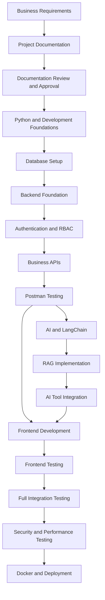

# 07 — Development Roadmap

**Project:** AI-Powered E-commerce Customer Support Agent  
**Document:** Development Roadmap  
**Version:** 1.1  
**Status:** Revised Draft — Pending Cross-Document Consistency Review and User Approval  
**Estimated Duration:** 8–12 Weeks (Provisional)  
**Development Approach:** Phase-by-Phase, Test-Driven and Incremental  
**Primary Language:** Python  
**Frontend:** React, TypeScript  
**AI Stack:** LangChain, OpenAI  
**Database:** PostgreSQL, pgvector

---

# 1. Introduction

## 1.1 Purpose

This document defines the implementation roadmap for the AI-Powered E-commerce Customer Support Agent.

It explains:

- What to learn before implementation.
- Which features to build first.
- How to divide the project into phases.
- Which technologies to use in each phase.
- What deliverables are expected.
- How to test each module.
- When to move to the next phase.
- How to track project progress.

## 1.2 Development Philosophy

The project will be developed incrementally.

The developer should understand each component before implementing the next one.

The following rules apply throughout development:

1. Do not start coding before all eight project documents are approved.
2. Learn the minimum concepts required for each implementation phase.
3. Build small modules instead of writing the entire application at once.
4. Test each backend API in Postman.
5. Fix errors before moving to dependent features.
6. Use realistic mock data initially.
7. Integrate external services only after local workflows work.
8. Maintain Git commits throughout development.
9. Document important technical decisions.
10. Complete integration testing before deployment.

---

# 2. Overall Development Workflow

The project will follow this sequence:



Some independent activities, such as frontend preparation and AI learning, may overlap. However, dependent features must follow their required order.

---

# 3. Project Timeline

The following is a provisional 12-week plan.

| Phase | Duration | Main Deliverable |
|---|---:|---|
| 0. Documentation finalization | Before development | Approved project documents |
| 1. Learning foundations | Week 1 | Python and Git readiness |
| 2. Database and backend foundation | Week 2 | Running FastAPI and PostgreSQL |
| 3. Authentication and authorization | Week 3 | Secure login and RBAC |
| 4. Core business APIs | Week 4 | Orders, products and customers |
| 5. Support workflows | Week 5 | Refunds, cancellations and tickets |
| 6. AI and LangChain | Week 6 | Working AI conversation pipeline |
| 7. RAG implementation | Week 7 | Document ingestion and retrieval |
| 8. AI tool integration | Week 8 | AI connected to verified business operations |
| 9. Frontend development | Weeks 9–10 | Customer and staff interfaces |
| 10. Integration and hardening | Week 11 | Integrated, tested application |
| 11. Deployment and documentation | Week 12 | Deployable project |

Actual duration depends on learning progress, debugging and available time.

---

# 4. Phase 0 — Documentation Finalization

**Duration:** Before development

<badge color="success">Current phase</badge>

## Objective

Complete all eight project documents and verify that they describe one consistent system.

## Tasks

1. Revise all eight documents.
2. Cross-check business requirements against the SRS.
3. Verify the SRS against the database schema.
4. Verify architecture against the API specification.
5. Check API routes against the folder structure.
6. Verify roadmap tasks against approved requirements.
7. Ensure the testing strategy covers all MVP workflows.
8. Resolve conflicting decisions.
9. Obtain final approval.

## Required Documents

| No. | Document | Filename |
|---:|---|---|
| 1 | Business Requirements Document | 01_BRD.md |
| 2 | Software Requirements Specification | 02_SRS.md |
| 3 | Technical Architecture | 03_Technical_Architecture.md |
| 4 | Database Design | 04_Database_Design.md |
| 5 | API Specification | 05_API_Specification.md |
| 6 | Project Folder Structure | 06_Project_Folder_Structure.md |
| 7 | Development Roadmap | 07_Development_Roadmap.md |
| 8 | Testing Strategy | 08_Testing_Strategy.md |

## Deliverables

- Eight approved Markdown documents.
- Consistent requirements and database entities.
- Agreed MVP scope.
- Confirmed technical decisions.
- Recorded unresolved business decisions.

## Exit Criteria

Do not begin implementation until all eight documents have been reviewed and approved.

---

# 5. Phase 1 — Learning Foundations

**Duration:** Week 1

## Objective

Learn the minimum Python, Git and development concepts required to build the backend.

The goal is not to master every Python feature. The goal is to understand the concepts used in this project.

## 5.1 Python Fundamentals

Topics:

1. Variables and data types.
2. Conditional statements.
3. Loops.
4. Functions.
5. Lists and dictionaries.
6. Sets and tuples.
7. List and dictionary operations.
8. Classes and objects.
9. Inheritance and encapsulation.
10. Exception handling.
11. Modules and packages.
12. File handling.
13. Virtual environments.
14. Installing packages using pip.
15. Type hints.
16. Basic asynchronous programming.

## 5.2 Python Practice

Implement small exercises:

- Customer information manager.
- Product inventory manager.
- Order status checker.
- Refund eligibility checker.
- File reader.
- Simple menu-driven customer support application.

These exercises should use Python fundamentals before introducing FastAPI or LangChain.

## 5.3 Git and GitHub

Learn:

- Repository creation.
- `git init`
- `git clone`
- `git status`
- `git add`
- `git commit`
- `git push`
- `git pull`
- Branch creation.
- Branch merging.
- Pull requests.
- `.gitignore`

## 5.4 Development Tools

Install and configure:

- Python.
- VS Code or another Python IDE.
- Git.
- Postman.
- PostgreSQL.
- Docker Desktop.
- Node.js and npm.

## Deliverables

- Python practice programs.
- GitHub repository initialized.
- Python virtual environment configured.
- Development tools working.

## Exit Criteria

The developer can:

- Write and execute Python functions.
- Understand classes and exceptions.
- Install and import packages.
- Create and activate a virtual environment.
- Commit and push code to GitHub.

---

# 6. Phase 2 — Database and Backend Foundation

**Duration:** Week 2

## Objective

Create the backend foundation and establish database connectivity.

## 6.1 Learn FastAPI

Topics:

1. What is an API?
2. What is REST?
3. HTTP methods.
4. HTTP status codes.
5. Request and response bodies.
6. Path parameters.
7. Query parameters.
8. Pydantic models.
9. Dependency injection.
10. Middleware.
11. API documentation.
12. Asynchronous endpoints.

## 6.2 Learn PostgreSQL

Topics:

1. Database fundamentals.
2. Tables and columns.
3. Primary keys.
4. Foreign keys.
5. Relationships.
6. Constraints.
7. Joins.
8. Indexes.
9. Transactions.
10. SQL queries.
11. PostgreSQL extensions.
12. pgvector fundamentals.

## 6.3 Learn SQLAlchemy and Alembic

Understand:

- ORM concepts.
- Database models.
- Sessions.
- Queries.
- Relationships.
- Transactions.
- Database migrations.
- Schema versioning.

## 6.4 Implementation Tasks

1. Create the GitHub project structure.
2. Create the Python virtual environment.
3. Install backend dependencies.
4. Initialize FastAPI.
5. Configure application settings.
6. Configure PostgreSQL.
7. Connect SQLAlchemy.
8. Configure Alembic.
9. Enable pgvector.
10. Create a health-check endpoint.
11. Run the first database migration.

## Initial APIs

| Endpoint | Purpose |
|---|---|
| `GET /health` | Verify application health |
| `GET /api/v1/health/database` | Verify database connectivity |

The health endpoints should not expose credentials or internal infrastructure details.

## Deliverables

- Running FastAPI application.
- PostgreSQL connection.
- SQLAlchemy configuration.
- Alembic migration setup.
- pgvector extension enabled.
- Health-check endpoints tested.

## Exit Criteria

- Backend starts successfully.
- Database connection works.
- Initial migration executes.
- Postman can access health endpoints.

---

# 7. Phase 3 — Authentication and Authorization

**Duration:** Week 3

## Objective

Implement secure user authentication and role-based access control.

This phase is a prerequisite for exposing customer-specific business data.

## 7.1 Learning Topics

- Password hashing.
- JWT.
- Access tokens.
- Refresh tokens.
- Cookies.
- CSRF.
- Authentication versus authorization.
- RBAC.
- Permission checks.
- Resource ownership.
- SQLAlchemy relationships.

## 7.2 Implementation Tasks

1. Create user and customer models.
2. Create role and permission models.
3. Create user-role relationships.
4. Create role-permission relationships.
5. Implement password hashing.
6. Implement registration.
7. Implement login.
8. Generate access tokens.
9. Implement refresh-token cookies.
10. Implement refresh-token rotation.
11. Implement token revocation.
12. Implement logout.
13. Implement current-user endpoint.
14. Implement permission dependencies.
15. Implement customer ownership checks.
16. Implement initial account management.

## APIs to Build

```text
POST /api/v1/auth/register
POST /api/v1/auth/login
POST /api/v1/auth/refresh
POST /api/v1/auth/logout
GET  /api/v1/auth/me

GET  /api/v1/customers/me
PATCH /api/v1/customers/me
```

## Security Tests

- Invalid credentials.
- Expired access token.
- Revoked refresh token.
- Refresh-token reuse.
- Customer accessing another customer's profile.
- Unauthorized administrator access.
- Missing permission.

## Deliverables

- Working authentication.
- Role-based authorization.
- Secure refresh-token handling.
- Customer ownership enforcement.
- Postman authentication collection.

## Exit Criteria

A customer can register, log in, retrieve their profile and log out.

A customer cannot access another customer's protected information.

---

# 8. Phase 4 — Core Business APIs

**Duration:** Week 4

## Objective

Build the verified business-data foundation before connecting AI.

The backend must be able to answer customer questions without depending on an LLM.

## 8.1 Learning Topics

- SQLAlchemy relationships.
- Repository pattern.
- Service layer.
- Request validation.
- Response schemas.
- Pagination.
- Filtering.
- Database transactions.
- Database constraints.

## 8.2 Implementation Tasks

### Customer Module

- View profile.
- Update profile.
- Retrieve customer context.

### Product Module

- Create products.
- List products.
- Retrieve product details.
- Check product availability.
- Update product information.

### Order Module

- Create mock orders.
- List customer orders.
- Retrieve order details.
- Retrieve order by order number.
- Retrieve tracking events.
- Verify order ownership.

## 8.3 Mock Data

Create realistic development data:

- One demo business.
- Admin user.
- Support agent.
- Business owner.
- Multiple customers.
- Products.
- Inventory.
- Orders.
- Order items.
- Tracking events.

All customer relationships must be consistent.

## 8.4 APIs to Build

```text
GET    /api/v1/products
GET    /api/v1/products/{product_id}
GET    /api/v1/products/{product_id}/availability

GET    /api/v1/orders/me
GET    /api/v1/orders/{order_id}
GET    /api/v1/orders/number/{order_number}
GET    /api/v1/orders/{order_id}/tracking

GET    /api/v1/customers/me
PATCH  /api/v1/customers/me
```

Administrative product and order APIs shall follow the API specification.

## 8.5 Postman Testing

Test:

- Valid product retrieval.
- Invalid product ID.
- Order ownership.
- Tracking retrieval.
- Product availability.
- Pagination.
- Invalid input.
- Unauthorized access.

## Deliverables

- Customer service.
- Product service.
- Order service.
- Mock business data.
- Working APIs.
- Postman test results.

## Exit Criteria

The backend can retrieve accurate product and order information independently of AI.

---

# 9. Phase 5 — Support Business Workflows

**Duration:** Week 5

## Objective

Implement refund, cancellation and support-ticket workflows.

These workflows must be controlled by backend business rules.

## 9.1 Learning Topics

- Business-rule implementation.
- State transitions.
- Database transactions.
- Idempotency.
- Audit logging.
- Foreign-key relationships.
- Workflow validation.

## 9.2 Refund Implementation

Tasks:

1. Create refund policy models.
2. Implement versioned policy configuration.
3. Implement eligibility checks.
4. Validate order ownership.
5. Calculate eligible amounts.
6. Create confirmed refund requests.
7. Implement human approval.
8. Record refund status changes.
9. Record audit events.

Important rules:

- No active policy means fail safely.
- A successful eligibility check is not an approval.
- Actual refund execution is not part of the MVP.
- Duplicate requests must be prevented.

## 9.3 Cancellation Implementation

Tasks:

1. Create cancellation request model.
2. Implement eligibility checks.
3. Implement customer confirmation.
4. Create pending-review requests.
5. Implement staff review.
6. Record decisions.
7. Update request status.
8. Notify the customer.

Cancellation execution must not happen automatically.

## 9.4 Ticket Implementation

Tasks:

1. Create support ticket model.
2. Create assignment model.
3. Create internal notes.
4. Create ticket activity history.
5. Implement ticket creation.
6. Implement assignment.
7. Implement status transitions.
8. Implement escalation.
9. Implement reopening.
10. Enforce customer/staff visibility rules.

## 9.5 Notification and Audit Implementation

- Create in-app notification records.
- Implement simulated email notifications.
- Record important administrative operations.
- Record refund and cancellation decisions.

## APIs to Build

```text
POST /api/v1/refunds/eligibility
POST /api/v1/refunds
GET  /api/v1/refunds/me

POST /api/v1/cancellations/eligibility
POST /api/v1/cancellations

POST /api/v1/tickets
GET  /api/v1/tickets/me
GET  /api/v1/tickets/{ticket_id}
PATCH /api/v1/tickets/{ticket_id}/status
POST /api/v1/tickets/{ticket_id}/assign
POST /api/v1/tickets/{ticket_id}/notes
POST /api/v1/tickets/{ticket_id}/escalate

GET  /api/v1/notifications
```

## Deliverables

- Refund workflow.
- Cancellation workflow.
- Ticket management.
- Human-review operations.
- Notification records.
- Audit records.

## Exit Criteria

All core support workflows work through backend APIs and have been tested in Postman.

---

# 10. Phase 6 — AI and LangChain Foundations

**Duration:** Week 6

## Objective

Understand LLM integration and build the first AI conversation pipeline.

AI integration begins after the core business APIs are working.

## 10.1 Learning Topics

### AI Fundamentals

- Artificial Intelligence.
- Machine Learning.
- Deep Learning.
- Large Language Models.
- Tokens.
- Context windows.
- Temperature.
- System prompts.
- User prompts.
- Hallucinations.
- Embeddings.
- Model API calls.

### LangChain

- Chat model integration.
- Prompt templates.
- Structured output.
- Chains and runnable pipelines.
- Message history.
- Tool definitions.
- Tool execution.
- Output validation.

### API Integration

- OpenAI API.
- Environment variables.
- Timeouts.
- Error handling.
- Token usage.
- Cost awareness.

## 10.2 Implementation Tasks

1. Configure OpenAI credentials securely.
2. Create the OpenAI integration client.
3. Create LLM configuration.
4. Build a basic prompt pipeline.
5. Implement basic intent classification.
6. Create structured AI outputs.
7. Implement response generation.
8. Save conversation messages.
9. Load recent conversation context.
10. Implement insufficient-context handling.
11. Implement streaming responses.

## 10.3 Initial Intents

The system shall classify:

- Order tracking.
- Refund inquiry.
- Cancellation inquiry.
- Product inquiry.
- Shipping information.
- Return policy.
- Payment inquiry.
- Complaint.
- General FAQ.
- Human support request.

## 10.4 First AI Milestone

Build a simple chat flow:

```text
Customer Message
      |
      v
FastAPI Chat Endpoint
      |
      v
LangChain Pipeline
      |
      v
OpenAI Model
      |
      v
Generated Response
      |
      v
Save Conversation
      |
      v
Return Response
```

At this milestone, the model should answer basic general queries. It must not perform business operations independently.

## Deliverables

- Working LLM integration.
- Basic LangChain pipeline.
- Intent classifier.
- Conversation persistence.
- Streaming chat endpoint.

## Exit Criteria

The customer can send a message and receive a generated response, with conversation history saved.

---

# 11. Phase 7 — RAG Implementation

**Duration:** Week 7

## Objective

Build a knowledge-base system that allows the AI to answer questions using business documents.

## 11.1 Learning Topics

1. What is RAG?
2. What are embeddings?
3. Semantic similarity.
4. Cosine similarity.
5. Chunking.
6. Chunk overlap.
7. Vector databases.
8. pgvector.
9. Full-text search.
10. Hybrid retrieval.
11. Reciprocal Rank Fusion.
12. Retrieval evaluation.
13. Source citations.

## 11.2 Implementation Tasks

### Document Upload

1. Implement file validation.
2. Support PDF.
3. Support TXT.
4. Support DOCX.
5. Support CSV.
6. Support XLSX.
7. Implement website URL ingestion.

### Document Processing

1. Extract text.
2. Clean extracted content.
3. Preserve page and section metadata.
4. Split documents into chunks.
5. Generate embeddings.
6. Store document metadata.
7. Store chunks and vectors.
8. Update search indexes.

### Retrieval

1. Accept customer questions.
2. Generate query embeddings.
3. Run PostgreSQL full-text search.
4. Run pgvector similarity search.
5. Combine ranked results using RRF.
6. Select relevant chunks.
7. Build context.
8. Generate source citations.

## 11.3 Background Processing

Implement persistent jobs for:

- Document ingestion.
- Embedding generation.
- Website ingestion.
- Failed-job retry.

Use the PostgreSQL job table and a separate worker process.

## 11.4 RAG Evaluation

Prepare sample questions with known answers.

Measure:

- Whether relevant documents are retrieved.
- Whether the correct section is retrieved.
- Whether citations point to the correct source.
- Whether unsupported questions are handled safely.
- Retrieval latency.

## Deliverables

- Document ingestion pipeline.
- pgvector storage.
- Hybrid retrieval.
- RAG response generation.
- Source citations.
- Persistent ingestion jobs.

## Exit Criteria

The AI can answer questions using indexed company documents and provide available source references.

---

# 12. Phase 8 — AI Tool Integration

**Duration:** Week 8

## Objective

Connect the AI orchestration layer to verified backend business operations.

This is where the application becomes a customer-support agent rather than a simple chatbot.

## 12.1 Learning Topics

- Function calling.
- Tool schemas.
- Structured arguments.
- Tool execution.
- Authentication context.
- Authorization.
- Tool result validation.
- Human-in-the-loop workflows.
- Agent orchestration.

## 12.2 Tools to Implement

| Tool | Backend Service |
|---|---|
| Order lookup | OrderService |
| Product availability | ProductService |
| Customer context retrieval | CustomerService |
| Refund eligibility | RefundService |
| Refund request creation | RefundService |
| Cancellation request creation | CancellationService |
| Ticket creation | TicketService |
| Knowledge retrieval | RAG Service |
| Escalation | TicketService |
| Notification simulation | NotificationService |

## 12.3 Implementation Tasks

1. Create tool definitions.
2. Define strict input schemas.
3. Connect tools to business services.
4. Pass authenticated context from backend.
5. Implement permission checks.
6. Validate tool outputs.
7. Add explicit confirmation before sensitive requests.
8. Add audit logging.
9. Add error handling.
10. Test the full conversation workflow.

## 12.4 Example Workflow

Customer:

"Where is my order ORD-10001?"

Processing:

```text
Customer Message
      |
      v
Intent Classification
      |
      v
ORDER_TRACKING
      |
      v
Order Lookup Tool
      |
      v
Order Service
      |
      v
Ownership Verification
      |
      v
PostgreSQL
      |
      v
Verified Order Details
      |
      v
AI Response Generation
      |
      v
Customer Response
```

## 12.5 Security Validation

Test:

- LLM supplies another customer's ID.
- Customer asks to access another customer's order.
- Customer asks the AI to issue a refund directly.
- Customer asks the AI to cancel an order without review.
- Prompt injection attempts to override tool restrictions.
- Invalid tool arguments.
- Duplicate sensitive requests.

## Deliverables

- AI orchestrator.
- Controlled tool execution.
- Business-service integration.
- Human confirmation workflows.
- Escalation integration.

## Exit Criteria

The AI can identify customer intent and use approved tools without bypassing backend security or business rules.

---

# 13. Phase 9 — Frontend Development

**Duration:** Weeks 9–10

## Objective

Build the user interface and connect it to the tested backend APIs.

## 13.1 Learning Topics

- HTML.
- CSS.
- JavaScript fundamentals.
- TypeScript.
- React components.
- Props and state.
- Hooks.
- React Router.
- API requests.
- Axios.
- TanStack Query.
- Form validation.
- Authentication state.
- Streaming responses.

## 13.2 Frontend Setup

Tasks:

1. Initialize React with TypeScript.
2. Install dependencies.
3. Configure Tailwind CSS.
4. Configure React Router.
5. Configure Axios.
6. Configure TanStack Query.
7. Create shared UI components.
8. Implement authentication state.
9. Configure protected routes.
10. Implement role-based navigation.

## 13.3 Customer Portal

Build:

- Registration.
- Login.
- Customer dashboard.
- AI chat.
- Conversation history.
- Order list.
- Order tracking.
- Refund request and status.
- Cancellation request and status.
- Support tickets.
- Profile management.
- Notifications.

## 13.4 Support Dashboard

Build:

- Assigned tickets.
- Ticket filters.
- Ticket details.
- Conversation history.
- Internal notes.
- Customer context.
- Assignment controls.
- Status management.
- Escalation controls.

## 13.5 Admin Dashboard

Build:

- User management.
- Role management.
- Product management.
- Order management.
- Knowledge-base document management.
- AI configuration.
- Audit logs.

## 13.6 Owner Dashboard

Build:

- Ticket volume.
- Ticket status.
- AI versus human handling.
- Response time.
- Resolution time.
- Common query categories.

## 13.7 Frontend Quality

Implement:

- Loading states.
- Error states.
- Empty states.
- Form validation.
- Toast notifications.
- Responsive layout.
- Pagination.
- Accessible controls.
- Dark/light mode where appropriate.

## Deliverables

- Customer portal.
- Support dashboard.
- Admin dashboard.
- Owner dashboard.
- Frontend API integration.

## Exit Criteria

All major user workflows can be completed through the frontend using backend APIs.

---

# 14. Phase 10 — Integration and Quality Assurance

**Duration:** Week 11

## Objective

Validate that the complete application works as one integrated system.

## 14.1 Integration Testing

Test complete customer journeys:

### Workflow A: Order Tracking

1. Customer logs in.
2. Opens chat.
3. Requests order status.
4. AI identifies intent.
5. Backend verifies ownership.
6. Order details are retrieved.
7. AI returns the verified result.

### Workflow B: Refund

1. Customer logs in.
2. Requests a refund.
3. Eligibility is checked.
4. Customer confirms.
5. Request is created.
6. Staff reviews the request.
7. Customer receives a status update.

### Workflow C: RAG

1. Admin uploads a document.
2. Worker processes it.
3. Embeddings are stored.
4. Customer asks a question.
5. Hybrid retrieval finds relevant chunks.
6. AI generates an answer.
7. Source citations are displayed.

### Workflow D: Human Escalation

1. Customer asks an unresolved question.
2. AI identifies the need for escalation.
3. Ticket is created.
4. Support agent receives the ticket.
5. Agent responds.
6. Customer sees the update.

## 14.2 Security Testing

Test:

- Authentication failures.
- Authorization failures.
- Customer ownership violations.
- Role escalation attempts.
- CSRF protection.
- Rate limiting.
- File upload restrictions.
- Prompt injection.
- Refresh-token reuse.
- Idempotency.
- Sensitive-data exposure.

## 14.3 Performance Testing

Measure:

- API latency.
- Database query performance.
- AI response latency.
- Streaming latency.
- RAG retrieval latency.
- Worker processing time.
- Concurrent-user behavior.

Use the provisional NFR targets in the SRS as initial benchmarks.

## 14.4 Bug Fixing

All critical defects must be resolved before deployment.

Record defects with:

- Description.
- Steps to reproduce.
- Expected result.
- Actual result.
- Severity.
- Resolution.
- Regression test.

## Deliverables

- Integration test results.
- Security test results.
- Performance measurements.
- Bug-fix records.
- Release candidate.

## Exit Criteria

All critical MVP workflows pass the agreed test cases.

---

# 15. Phase 11 — Deployment and Final Documentation

**Duration:** Week 12

## Objective

Prepare the application for deployment and demonstrate the completed project.

## 15.1 Learning Topics

- Docker.
- Docker Compose.
- Environment variables.
- Production configuration.
- HTTPS.
- Database backups.
- Logging.
- Monitoring.
- Deployment troubleshooting.

## 15.2 Implementation Tasks

1. Create backend Dockerfile.
2. Create frontend Dockerfile.
3. Configure worker runtime.
4. Configure PostgreSQL with pgvector.
5. Create Docker Compose configuration.
6. Configure environment variables.
7. Run migrations.
8. Load approved demo data.
9. Configure secure production settings.
10. Deploy backend.
11. Deploy worker.
12. Deploy frontend.
13. Verify API connectivity.
14. Run smoke tests.
15. Verify logs and background jobs.
16. Document deployment steps.

## 15.3 Final Deliverables

- Running application.
- GitHub repository.
- Approved project documents.
- API documentation.
- Postman collection.
- Test results.
- Database migration history.
- Deployment instructions.
- Demo data.
- Project demonstration.

## Exit Criteria

The deployed application passes the release smoke tests and all required MVP workflows are operational.

---

# 16. Git and Version Control Strategy

## 16.1 Branch Strategy

Recommended branches:

```text
main
develop
feature/authentication
feature/orders
feature/refunds
feature/tickets
feature/ai-agent
feature/rag
feature/frontend
```

For a solo learning project, this can be simplified. The important rule is to avoid developing untested changes directly on the stable main branch.

## 16.2 Commit Convention

Examples:

```text
feat: add customer registration
feat: implement order tracking
feat: add refund eligibility validation
feat: implement rag document ingestion

fix: resolve token refresh issue
fix: correct order ownership validation

test: add refund service tests
docs: update api specification
refactor: separate ticket service logic
```

## 16.3 Commit Frequency

Commit after a meaningful, tested unit of work.

Avoid committing:

- `.env` files.
- API keys.
- Passwords.
- Private customer data.
- Unnecessary generated files.

---

# 17. Learning Resources and Study Strategy

Learning should be directly connected to the phase being implemented.

Recommended study order:

| Topic | Learn Before |
|---|---|
| Python fundamentals | Backend development |
| Git and GitHub | Project initialization |
| SQL and PostgreSQL | Database implementation |
| FastAPI | API development |
| Pydantic | Request validation |
| SQLAlchemy | Database integration |
| JWT and RBAC | Authentication |
| LangChain | AI pipeline |
| Embeddings and vector search | RAG |
| Tool calling | AI business integration |
| React and TypeScript | Frontend development |
| Docker | Deployment |

Use official documentation where possible.

Suggested official resources:

- Python: https://docs.python.org/3/
- FastAPI: https://fastapi.tiangolo.com/
- PostgreSQL: https://www.postgresql.org/docs/
- SQLAlchemy: https://docs.sqlalchemy.org/
- Alembic: https://alembic.sqlalchemy.org/
- LangChain: https://docs.langchain.com/
- OpenAI API: https://platform.openai.com/docs/
- React: https://react.dev/
- TypeScript: https://www.typescriptlang.org/docs/
- Docker: https://docs.docker.com/

Documentation versions should be checked against the actual project dependencies.

---

# 18. Cost-Control Strategy

The project should minimize unnecessary paid services during learning.

## 18.1 Development Strategy

- Use local PostgreSQL.
- Use Docker for reproducible environments.
- Start with mock products and orders.
- Use small sample documents.
- Avoid unnecessary model calls.
- Limit retrieved chunks.
- Keep prompts concise.
- Cache safe, reusable results where appropriate.
- Monitor token usage.
- Use deterministic mock responses in tests.

## 18.2 AI Testing Strategy

Not every test needs a real LLM API call.

Use:

- Mock LLM responses for unit tests.
- Recorded sample outputs for deterministic tests.
- Limited real API tests for integration validation.
- A small curated question set for RAG evaluation.

This reduces cost and makes test results reproducible.

---

# 19. Project Milestones and Completion Gates

| Milestone | Completion Condition |
|---|---|
| M0 — Documentation approved | All eight documents reviewed and approved |
| M1 — Development environment | Python, Git, database and tools working |
| M2 — Backend foundation | FastAPI and PostgreSQL connected |
| M3 — Secure backend | Authentication and RBAC working |
| M4 — Business workflows | Orders, refunds, cancellations and tickets working |
| M5 — AI foundation | LLM and LangChain pipeline working |
| M6 — RAG complete | Document ingestion, hybrid retrieval and citations working |
| M7 — Agent integration | AI can safely invoke approved backend tools |
| M8 — Frontend complete | Role-based application interfaces working |
| M9 — Integration complete | End-to-end workflows pass |
| M10 — Release ready | Security, performance and smoke tests pass |
| M11 — Deployment complete | Application deployed and documented |

Each milestone requires validation before dependent work proceeds.

---

# 20. Risk Management

| Risk | Impact | Mitigation |
|---|---|---|
| Beginner learning curve | Delays | Learn incrementally and build small exercises |
| OpenAI API costs | Increased expenses | Mock tests, token limits and usage monitoring |
| LLM hallucinations | Incorrect support responses | Ground answers and validate business data |
| Unauthorized data access | Security incident | RBAC and resource ownership checks |
| Incorrect refund rules | Financial workflow errors | Configurable policies and human approval |
| Incorrect cancellation | Customer impact | Pending-review workflow |
| Poor retrieval quality | Incorrect answers | Evaluate chunking and retrieval quality |
| Background job failures | Incomplete processing | Persistent jobs and retries |
| Integration defects | Application instability | Incremental integration testing |
| Scope expansion | Delayed delivery | Protect the approved MVP boundary |
| Deployment configuration errors | Production failure | Environment validation and smoke tests |

---

# 21. MVP Definition of Done

The MVP shall be considered complete when:

- [ ] All eight project documents are approved.
- [ ] Backend runs successfully.
- [ ] PostgreSQL and pgvector are configured.
- [ ] Authentication and RBAC work.
- [ ] Customer resource ownership is enforced.
- [ ] Customer profile management works.
- [ ] Product and order APIs work.
- [ ] Refund eligibility and human approval work.
- [ ] Cancellation request and human review work.
- [ ] Support ticket workflows work.
- [ ] AI chat works.
- [ ] Basic intent classification works.
- [ ] Conversation history is saved.
- [ ] RAG document ingestion works.
- [ ] Hybrid retrieval works.
- [ ] Source citations are returned.
- [ ] Approved AI tools work.
- [ ] Human escalation works.
- [ ] Notifications are recorded.
- [ ] Background jobs are persistent.
- [ ] Audit logs are recorded.
- [ ] Customer, support and admin interfaces work.
- [ ] Basic owner analytics work.
- [ ] Postman API tests pass.
- [ ] Automated tests cover critical workflows.
- [ ] Security tests pass.
- [ ] Docker environment works.
- [ ] Deployment smoke tests pass.

---

# 22. Project Progress Tracking Template

Update this checklist as implementation progresses.

## Documentation

- [ ] BRD approved.
- [ ] SRS approved.
- [ ] Technical Architecture approved.
- [ ] Database Design approved.
- [ ] API Specification approved.
- [ ] Folder Structure approved.
- [ ] Development Roadmap approved.
- [ ] Testing Strategy approved.

## Development

- [ ] Python foundations.
- [ ] GitHub setup.
- [ ] FastAPI setup.
- [ ] PostgreSQL setup.
- [ ] SQLAlchemy and Alembic.
- [ ] Authentication.
- [ ] RBAC.
- [ ] Customer module.
- [ ] Product module.
- [ ] Order module.
- [ ] Refund module.
- [ ] Cancellation module.
- [ ] Ticket module.
- [ ] Notification module.
- [ ] AI orchestration.
- [ ] RAG pipeline.
- [ ] AI tools.
- [ ] Background worker.
- [ ] Frontend.
- [ ] Integration tests.
- [ ] Security tests.
- [ ] Deployment.

---

# 23. Dependencies on Other Documents

| Document | Filename | Relationship |
|---|---|---|
| Business Requirements | 01_BRD.md | Defines business scope |
| Software Requirements | 02_SRS.md | Defines functional requirements |
| Technical Architecture | 03_Technical_Architecture.md | Defines system architecture |
| Database Design | 04_Database_Design.md | Defines data structures |
| API Specification | 05_API_Specification.md | Defines API contracts |
| Project Folder Structure | 06_Project_Folder_Structure.md | Defines code organization |
| Development Roadmap | 07_Development_Roadmap.md | Defines implementation order |
| Testing Strategy | 08_Testing_Strategy.md | Defines quality validation |

---

# 24. Approval Status

**Document:** 07_Development_Roadmap.md  
**Version:** 1.1  
**Status:** Revised Draft — Pending Cross-Document Consistency Review and User Approval

The roadmap is a provisional implementation plan. Actual implementation shall begin only after all eight documents have been revised, cross-checked and approved.